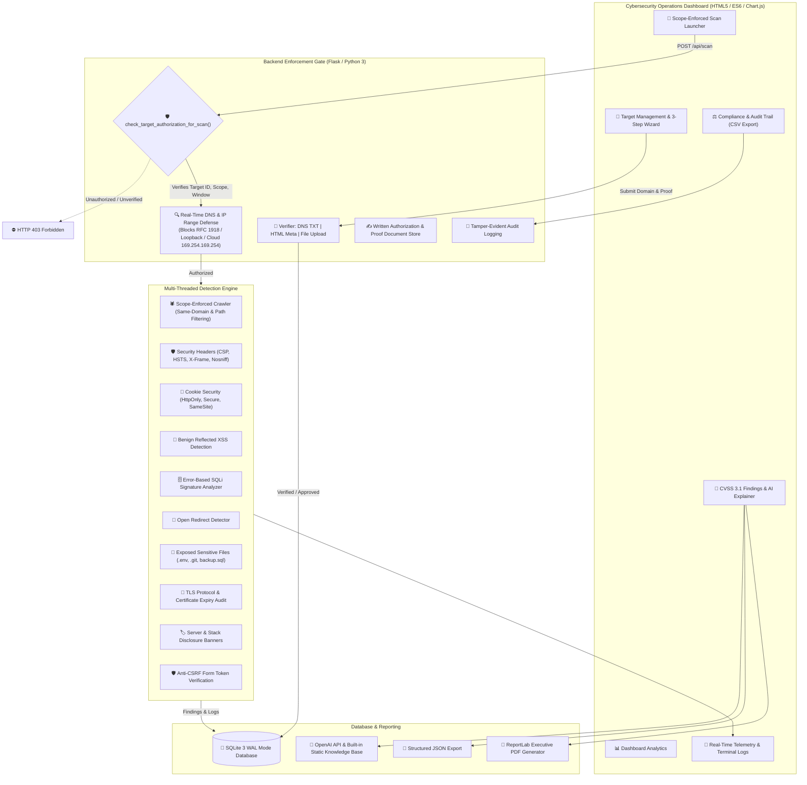

# ⚡ SecureScan AI — Web Application Vulnerability Scanner & Target Authorization Management

[](https://python.org)
[](#legal-and-ethical-use-policy)
[](LICENSE)

**SecureScan AI** is a production-grade, full-stack defensive web application vulnerability assessment platform featuring an advanced glassmorphism dark-mode operations dashboard, multi-threaded detection engine, and an **Authorized Target Management System** enforcing cryptographic ownership verification, SSRF protection, strict scope boundaries, and third-party written authorization workflows.

---

## 🏛️ System Architecture



---

## 🔒 Legal and Ethical Use Policy

> [!IMPORTANT]
> **Strict Authorization Enforcement:** SecureScan AI is strictly engineered for defensive cybersecurity assessments, authorized penetration testing, and educational research. Testing targets without documented ownership or explicit written authorization from the system owner violates the Computer Fraud and Abuse Act (CFAA), UK Computer Misuse Act, and international computer crime statutes.

### Mandatory Safety Controls:
1. **Backend Verification Gate:** No scan can be launched unless the target exists in the authorized database with status `Verified` or `Approved`. Free-text scanning of arbitrary URLs is blocked with `HTTP 403 Forbidden`.
2. **Granular Scope Enforcement:** Scans and crawlers are strictly confined to authorized domains and designated in-scope paths (e.g. `/api/*`). Excluded paths (e.g. `/admin`, `/payment`, `/logout`) are rejected automatically.
3. **SSRF and DNS-Rebinding Defense:** Outbound requests resolve hostnames immediately before fetching and verify that the target IP does not belong to RFC 1918 private ranges, loopback addresses, link-local addresses, or cloud metadata endpoints (`169.254.169.254`), unless explicitly cleared as an educational lab target.
4. **Non-Destructive Detection Only:** Employs harmless benign probe markers. Never performs database truncation, Denial of Service (DoS), brute force, persistent modification, or credential theft.
5. **Rate-Limiting & Transparent Telemetry:** Enforces operator-defined requests-per-second quotas and transmits an identifiable `User-Agent: SecureScanAI/1.0 (authorized security scan; contact: <email>)` banner on every HTTP request.
6. **Global Emergency Kill Switch:** Allows instant termination of all active threads and prevents any new scans from starting.

---

## 🎯 Target Verification Workflows

SecureScan AI supports three classifications of targets:

### 1. Educational Lab Targets (Pre-Approved)
- Pre-approved testing sandboxes: `localhost`, `127.0.0.1`, `testphp.vulnweb.com`, `testasp.vulnweb.com`, and `juice-shop.herokuapp.com`.
- Automatically approved for educational testing.

### 2. Own Websites (Ownership Verification)
Users can choose one of three automated verification methods:
- **DNS TXT Record:** Generates a cryptographically random token (`secrets.token_hex(16)`). The domain owner adds a TXT record:
  ```dns
  securescan-verify=<token>
  ```
  The backend queries authoritative DNS servers via `dnspython` to validate the record.
- **HTML Meta Tag:** The owner places a meta tag within the `<head>` of their homepage:
  ```html
  <meta name="securescan-verification" content="<token>">
  ```
- **Well-Known File Upload:** The owner uploads a plaintext file accessible at:
  ```http
  https://<domain>/.well-known/securescan-verify.txt
  ```

### 3. Third-Party Websites (Written Authorization)
For consultants and enterprise teams scanning client infrastructure:
- Submits authorizer details (Full Name, Designation, Organization, Official Email, Phone).
- Defines the authorized testing window (Start and End datetime) and request velocity limit.
- Uploads documented proof (PDF, PNG, JPG up to 5MB, stored safely with randomized UUID filenames).
- Operator signs mandatory legal declarations.
- Generates an approval link (`/approve/<token>`). Once confirmed by the authorizer (or simulated in demo mode), testing privileges are unlocked.

---

## 🚀 Quickstart & Installation

### Prerequisites
- Python 3.11+
- pip

### 1. Clone & Setup Environment
```bash
cd /Users/vinodkumar/.gemini/antigravity/scratch/securescan-ai

# Create virtual environment
python3 -m venv .venv
source .venv/bin/activate

# Install dependencies
pip install -r requirements.txt
```

### 2. Configure Environment (Optional)
```bash
cp .env.example .env
```
Edit `.env` to configure your contact email or an optional `OPENAI_API_KEY`. If no OpenAI key is set, SecureScan AI automatically falls back to its comprehensive built-in static cybersecurity knowledge base.

### 3. Initialize Database & Seed Demo Data
```bash
python migrate.py
```

### 4. Run the Application
```bash
python app.py
```
Open your browser to: **`http://localhost:5000`**

---

## 🧪 Automated Security & Compliance Test Suite

Execute the unit and integration test suite:

```bash
# Run unit security enforcement tests
python test_security.py

# Run live end-to-end integration scan on local sandbox
python test_live_server.py
```

### Test Coverage Highlights:
- ✅ **Unverified Target Blocked:** Verifies `HTTP 403 Forbidden` when attempting to scan unverified hosts.
- ✅ **Out-of-Scope Path Blocked:** Validates path-level boundary enforcement (e.g. `/admin` exclusion).
- ✅ **Expired Authorization Blocked:** Confirms scan rejection when testing window has lapsed.
- ✅ **SSRF & Metadata IP Defense:** Verifies rejection of RFC 1918, loopback, and cloud metadata IPs (`169.254.169.254`).
- ✅ **Verification Approval Flow:** Confirms authorizer token validation and target state transition.
- ✅ **Live End-to-End Scan:** Tests crawling, security headers, XSS benign marker reflection, CSRF token absence, and ReportLab PDF compilation on a live local target.

---

## 📋 Viva & Defense Explanations (Scanner Modules)

| Module | Detection Methodology | Defense / Remediation |
|---|---|---|
| **Crawler (`crawler.py`)** | BFS crawler with depth control; extracts `<a href>`, `<form>`, and input tags; enforces in-scope paths and skips media/binaries. | Ensure private admin endpoints are not crawlable; configure robots.txt and authenticated access control. |
| **Security Headers (`headers.py`)** | Analyzes response headers for missing or weak `Content-Security-Policy`, `Strict-Transport-Security`, `X-Frame-Options`, `X-Content-Type-Options`, `Referrer-Policy`, and `Permissions-Policy`. | Deploy restrictive CSP (`default-src 'self'`), HSTS (`max-age=31536000; includeSubDomains`), and `X-Frame-Options: DENY`. |
| **Cookie Flags (`cookies.py`)** | Inspects `Set-Cookie` headers for missing `HttpOnly` (preventing XSS cookie theft), `Secure` (forcing TLS transmission), and `SameSite` flags. | Configure `HttpOnly; Secure; SameSite=Lax` on all session identifiers. |
| **Reflected XSS (`xss.py`)** | Injects benign non-executable marker tags (`<securescan_test_marker_x78>`) into URL parameters and form inputs; inspects response body for unescaped reflection. | Implement contextual HTML entity encoding and modern templating auto-escaping (e.g. Jinja2, React DOM). |
| **SQL Injection (`sqli.py`)** | Injects harmless syntax-breaking probes (`'`, `"`, `\`) and scans response text for database syntax errors across MySQL, PostgreSQL, MSSQL, Oracle, and SQLite. | Implement parameterized queries (prepared statements) or ORM abstractions; never concatenate untrusted strings. |
| **Open Redirect (`redirect.py`)** | Tests parameters (`url`, `redirect`, `next`, `dest`) with external URLs; inspects `Location` headers on 301/302 redirects. | Validate redirect destinations against an internal whitelist of authorized relative paths. |
| **Sensitive Files (`files.py`)** | Checks for exposed `.env`, `.git/HEAD`, `backup.sql`, and robots.txt; verifies distinctive diagnostic signatures. | Deny web server access to dotfiles (`.*`) and database dumps; remove backups from public web roots. |
| **SSL / TLS Check (`ssl_check.py`)** | Evaluates negotiated TLS version (flags TLS 1.0/1.1), checks certificate expiration date, and audits HTTP-to-HTTPS redirection. | Enforce TLS 1.2+ minimum, automate certificate renewal with Let's Encrypt, and enforce permanent 301 HTTPS redirects. |
| **Info Disclosure (`info_disclosure.py`)** | Checks for detailed version numbers in `Server` and `X-Powered-By` headers; probes for unhandled debug stack traces. | Set `ServerTokens Prod` in Apache, `server_tokens off` in Nginx, and disable framework debug mode in production. |
| **CSRF Audit (`csrf.py`)** | Inspects state-changing POST forms for absence of hidden anti-CSRF token parameters. | Implement synchronizer token pattern or SameSite cookie protection with frameworks like Flask-WTF or Django CSRF middleware. |

---

## 📑 Project Structure

```
securescan-ai/
├── app.py                     # Flask backend, REST API routes & page controller
├── config.py                  # System configuration, timeouts, and rate limits
├── requirements.txt           # Python dependencies
├── .env.example               # Template environment configuration
├── README.md                  # System architecture, verification guide & viva manual
├── migrate.py                 # Database migration & demo data seed runner
├── test_security.py           # Unit security test suite (SSRF, scope, auth tests)
├── test_live_server.py        # End-to-end integration test with live Flask server
├── database/
│   ├── db.py                  # Thread-safe SQLite connection & schema initialization
│   └── seed_data.py           # Demo seed data (lab targets, pending authorizations, scan findings)
├── target_manager/
│   ├── scope_enforcer.py      # IP SSRF defense, in-scope/out-of-scope path filtering
│   ├── verifier.py            # Ownership verification (DNS TXT, meta tag, file upload)
│   └── authorization.py       # Third-party written authorization & proof upload handler
├── scanner/
│   ├── engine.py              # Multi-threaded orchestrator, rate limiter, kill switch
│   ├── crawler.py             # Scope-bound same-domain web crawler
│   ├── headers.py             # Security headers analyzer
│   ├── cookies.py             # Cookie flags auditor
│   ├── xss.py                 # Benign Reflected XSS detector
│   ├── sqli.py                # Non-destructive SQL injection detector
│   ├── redirect.py            # Open redirect auditor
│   ├── files.py               # Sensitive file & directory detector
│   ├── ssl_check.py           # TLS & certificate expiry validator
│   ├── info_disclosure.py     # Server banners & stack trace detector
│   └── csrf.py                # CSRF form token presence checker
├── ai/
│   └── explainer.py           # OpenAI API integration + local static cybersecurity knowledge base
├── reports/
│   ├── pdf_generator.py       # ReportLab executive PDF report generator
│   └── json_generator.py      # Structured JSON export generator
├── static/
│   ├── css/
│   │   ├── style.css          # Glassmorphism dark layout & CSS variables
│   │   └── components.css     # Steppers, cards, badges, terminal console, gauges
│   └── js/
│       ├── app.js             # SPA router, theme toggler, and toast notifications
│       ├── dashboard.js       # Chart.js analytics & animated stat counters
│       ├── targets.js         # 3-Step target wizard & verification manager
│       ├── scan.js            # Scan launcher & live terminal log polling
│       ├── results.js         # Findings filters, CVSS cards & AI advisory modal
│       ├── history.js         # Scan history & comparative scan diff tool
│       └── compliance.js      # Audit trail table & CSV export
├── templates/
│   └── index.html             # Single-page dashboard application template
└── uploads/
    └── authorizations/        # Secure upload directory for written authorization documents
```

---

## 📜 License
Released under the MIT License. Developed for authorized defensive auditing and cybersecurity training.
